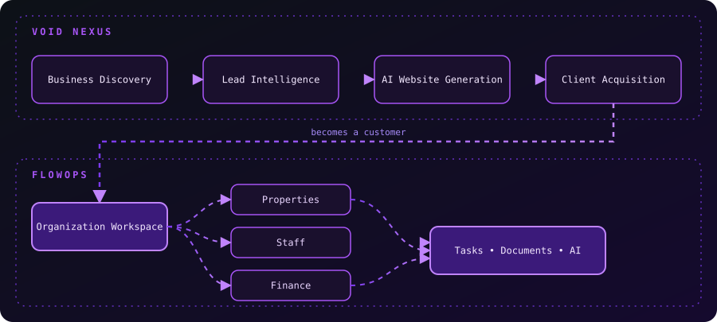

<!-- ═══════════════ HEADER ═══════════════ -->

  

  

  
  
  

  

## About

Backend-focused software developer building **systems, APIs, and AI-powered products**. Self-taught, from South Africa, working primarily with Python, Go, TypeScript, SQL and modern AI tooling.

I'm building an ecosystem that spans **education, business automation and operations**, while going deep on distributed systems, databases, Linux, cloud infrastructure and AI.

## Tech Stack

  <b>Languages</b>  
  

  <b>Frameworks & Frontend</b>  
  

  <b>Data</b>  
  

  <b>Infrastructure & Tooling</b>  
  

## Featured Projects

<table>
<tr>
<td width="33%" valign="top">

### Pick10
**AI Subject Selection & Career Guidance**

Helps South African learners make informed Grade 10 subject choices using academic data, career pathways and AI recommendations. The entry point into the **LearnStack** education ecosystem.

    

- AI career recommendations (RIASEC)
- Subject selection workflows
- Student & school management
- Analytics dashboards
- API-first architecture

</td>
<td width="33%" valign="top">

### FlowOps
**Enterprise Operations Platform**

A multi-tenant platform that manages everything *after* a business becomes a customer. The operational core of the Void ecosystem: workflows, staff, documents, maintenance, finance, communication and AI automation.

    

- Organization & workspace management
- Multi-role RBAC (Owner, PM, Staff, Tenant)
- Property, tenant & lease management
- Maintenance & inspections
- Financial reporting & payments
- Document intelligence
- AI workflow automation

</td>
<td width="33%" valign="top">

### VOID Nexus
**AI Business Acquisition Engine**

Discovers businesses without websites, generates AI-powered website previews, scores leads, runs outreach and converts prospects into FlowOps customers.

    

- Business discovery
- Lead scoring
- AI website generation
- Preview & revisions
- Outreach automation
- Client onboarding

</td>
</tr>
</table>

### How the ecosystem fits together

  

## Current Focus

<table>
<tr>
<td><b>Backend engineering</b> & system architecture</td>
<td><b>Distributed systems</b> with Go & Python</td>
</tr>
<tr>
<td><b>AI infrastructure</b>: Ollama, Groq, RAG</td>
<td><b>Multi-agent workflows</b> & automation</td>
</tr>
<tr>
<td><b>Database engineering</b> & query optimization</td>
<td><b>Linux servers</b>, networking & cloud</td>
</tr>
</table>

## GitHub Analytics

  
  

  

### Contribution Snake

  <picture>
    <source media="(prefers-color-scheme: dark)" srcset="https://raw.githubusercontent.com/PyBack-end/PyBack-end/output/github-snake-dark.svg"/>
    <source media="(prefers-color-scheme: light)" srcset="https://raw.githubusercontent.com/PyBack-end/PyBack-end/output/github-snake.svg"/>
    
  </picture>

## Open Source Interests

I'm keen to collaborate on projects involving:

| | |
|---|---|
| AI infrastructure & self-hosted LLMs | Backend engineering with Python & Go |
| Distributed systems & event-driven architecture | Developer tools & productivity platforms |
| Education technology | Cloud-native infrastructure |
| Open-source AI & automation systems | |

## Connect

  
  
  

  

  

